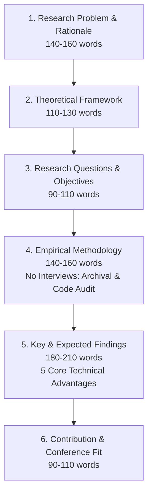

# Outline: Unicode Adoption and Its Advantages: A Study on Kannada Digital News Media

**Document Type:** Extended Abstract Outline (Target: ~800 words + 3–5 Keywords)  
**Working Title:** *Unicode Adoption and Its Advantages: A Study on Kannada Digital News Media*  
**Conference:** *Rethinking Communication in Regional Media: Platformisation, Labour, and Digital Publics*  
**Host & Collaboration:** Department of Media Studies, CHRIST (Deemed to be University), Bangalore Yeshwanthpur Campus, in collaboration with International Communication Association (ICA) India Chapter  
**Assigned Conference Themes:**  
- **Theme 1:** Transformations in Communication and Regional Media (*Digital transformation of regional journalism*)  
- **Theme 5:** Language, Culture and Regional Media Ecologies (*Vernacular and regional language media; Multilingual communication in digital spaces; Digital platforms and linguistic diversity*)  
**Methodological Design:** Purely **non-reactive / non-interview based** (Archival Web Analytics, Technical DOM/Metadata Audits, and Comparative Architectural Analysis).

---

## 📌 Executive Summary of Methodological Pivot (Avoiding Interviews)

| Dimension | Previous Plan (Impact-Focused) | Revised Plan (Adoption & Advantages Focused) |
| :--- | :--- | :--- |
| **Research Focus** | Sociological impact, newsroom labour, journalists' behavioral adaptation | Technical, infrastructural, and architectural advantages of Unicode over legacy font encodings |
| **Primary Method** | Semi-structured interviews ($N=6-8$) with journalists and editors | Longitudinal web archival analysis (Wayback Machine) + DOM/source-code technical forensic audits |
| **Corpus / Data** | Interview transcripts, qualitative coding | Historical snapshots (2000–2024) of 4 major Kannada digital news portals |
| **Feasibility & Risk** | High scheduling friction, editorial gatekeeping, subjective bias | 100% reproducible, objective technical evidence, immediately executable |

---

## 🏛️ Comprehensive Extended Abstract Structure (~800 Words Blueprint)

---

### Section 1: Research Problem & Rationale (~140–160 words)
- **Historical Context:**
  - The digital emergence of Kannada news media in the late 1990s and early 2000s relied on proprietary, non-standard ASCII/ISCII font glyph mappings (e.g., Baraha, Nudi, Akruti, Shree-Lipi, SRG).
  - Web publishing was restricted to visual typesetting: users had to manually download and install specific dynamic fonts (`.eot`, `.ttf`) or read static, scanned PDF/GIF images.
- **The Core Problem:**
  - While text appeared as Kannada to the human eye, to search engine bots, operating systems, and databases, it was unsearchable, non-interoperable Latin character gibberish (*mojibake*).
  - This created a "digital ghetto," severely isolating Kannada journalism from the emerging global semantic web, RSS syndication, and digital indexing.
- **The Turn to Unicode:**
  - The adoption of the universal Unicode Standard (UTF-8, Kannada block `U+0C80`–`U+0CFF`) represented a foundational infrastructural milestone, liberating regional language journalism from proprietary font constraints into open web standards.

---

### Section 2: Theoretical & Conceptual Framework (~110–130 words)
- **Media Infrastructure Studies (Star & Bowker; Plantin et al.):**
  - Conceptualizing character encoding protocols not merely as technical standards, but as invisible media infrastructures that govern language visibility, information access, and institutional distribution.
- **Platformisation of Regional Media (Poell, Nieborg, & Duffy; Udupa):**
  - Explores how platform ecosystems (search engines, news aggregators, social graphs) require standardized machine-readable data feeds to index, recommend, and algorithmically circulate vernacular news.
- **Linguistic Digital Divide & Semantic Interoperability (Neyazi; Berners-Lee):**
  - Moving beyond basic internet connectivity to examine text machine-readability as a prerequisite for democratic digital participation in regional language spheres.

---

### Section 3: Research Questions & Objectives (~90–110 words)
- **Primary Objective:** To examine the technical transition from legacy font-hack publishing to the Unicode standard in Kannada digital news media, and systematically map the structural and functional advantages unlocked by this standardization.
- **Research Questions (RQs):**
  - **RQ1 (Infrastructural Bottlenecks):** What technical, architectural, and communicative barriers characterized legacy font-encoded Kannada web journalism prior to widespread Unicode standardization?
  - **RQ2 (Architectural & Functional Advantages):** What specific technical advantages did Unicode adoption introduce in terms of platform interoperability, search engine indexing (SEO), database management, and cross-device rendering?
  - **RQ3 (Platform Integration & Circulation):** How did standard machine-readable text enable Kannada digital news to integrate into contemporary platformized distribution ecologies (social media metadata, RSS feeds, mobile news aggregators)?

---

### Section 4: Methodology & Empirical Corpus (~140–160 words)
*(Strictly designed to bypass the need for human interviews while retaining high academic rigor and reproducibility)*

- **Research Design:** Comparative historical web forensics and longitudinal technical content analysis.
- **Sampling & Corpus:**
  - Longitudinal case study of 4 pioneering Kannada news portals across 2 distinct eras:
    1. **Print-Legacy Broadsheets with Digital Desks:** *Prajavani* (`prajavani.net`), *Vijaya Karnataka* (`vijaykarnataka.com`), *Kannada Prabha* (`kannadaprabha.com`).
    2. **Digital-Native Vernacular Portal:** *ThatsKannada / Oneindia Kannada* (`kannada.oneindia.com`).
- **Data Collection via Digital Archival Retrieval:**
  - Utilization of the **Wayback Machine (Internet Archive)** to systematically retrieve homepage snapshots and article source code across three chronological phases:
    - *Phase 1 (Legacy Font Era, 2000–2006):* Dynamic font downloads, image-based text, ASCII hacks.
    - *Phase 2 (Transitional Era, 2007–2013):* Dual-publishing (Unicode + legacy Nudi/Baraha converters).
    - *Phase 3 (Unicode-Native Era, 2014–Present):* Full UTF-8 compliance, responsive mobile web, Open Graph semantic protocols.
- **Analytical Matrix / 5-Point Technical Evaluation:**
  1. *Character Encoding & Metadata:* Inspecting `<meta charset="...">` declarations and HTTP response headers.
  2. *DOM Machine-Readability:* Verifying copy-paste text extraction integrity vs. glyph fragmentation.
  3. *Search Crawler Visibility (SEO):* Evaluating headline/body extractability by algorithmic web spiders without font rendering engines.
  4. *Platform Metadata Integration:* Presence of Open Graph (`og:title`, `og:description`), Twitter Cards, and RSS/XML feed syndication in native Kannada script.
  5. *Client-Side Dependencies:* Independence from downloadable external `.ttf`/`.eot` font files.

---

### Section 5: Key / Expected Findings (~180–210 words)
*(Structured around the 5 Core Technical & Communicative Advantages of Unicode)*

1. **Universal Machine-Readability & Interoperability:**
   - Eradication of proprietary font lock-in: Text became hardware-, browser-, and OS-agnostic, functioning natively across Windows, macOS, Linux, Android, and iOS without client-side font installations.
   - Text portability: Enabled users to seamlessly copy, paste, quote, and store text across software applications without glyph disintegration.
2. **Search Engine Discoverability & SEO Modernization:**
   - Unlocked deep web indexing: Search algorithms (Google, Yahoo, Bing) could parse Kannada keywords in URL slugs, headline tags (`<h1>`, `<title>`), and body text, driving organic discovery for vernacular regional news.
3. **Platform Distribution & Algorithmic Circulation:**
   - Facilitated seamless integration with social media platforms (Facebook, X/Twitter, WhatsApp) via Open Graph metadata, rendering clean Kannada preview snippets and thumbnail descriptions.
   - Enabled automated ingestion into mobile news aggregators (Dailyhunt, Google News, Inshorts) via standardized UTF-8 XML/RSS feeds.
4. **Enhanced User Agency & Interactive Publics:**
   - Enabled real-time on-site search, automated tag filtering, and interactive reader commentary without requiring users to install specialized virtual keyboard software.
   - Enabled native accessibility tools (text-to-speech screen readers for visually impaired citizens).
5. **The Archival Paradox (Critical Finding):**
   - While modern content is preserved and searchable, thousands of early 2000s legacy news articles remain trapped in unindexed "archival black holes," demanding algorithmic font-transcoding tools to prevent digital cultural amnesia.

---

### Section 6: Contribution & Conference Alignment (~90–110 words)
- **Theoretical Contribution:**
  - Bridges technical computer engineering and critical media scholarship by empirically showing how character encoding protocols constitute foundational media infrastructures.
  - Demonstrates that regional vernacular platformisation is technically predicated on standardization protocols rather than market demand alone.
- **Conference Alignment:**
  - Directly addresses **Theme 1** (*Transformations in Communication and Regional Media - Digital transformation of regional journalism*) and **Theme 5** (*Language, Culture and Regional Media Ecologies - Multilingual communication in digital spaces and linguistic diversity*).
- **Target Keywords (3–5):**
  - `Unicode Standard`, `Kannada Digital Journalism`, `Media Infrastructure`, `Vernacular Platformisation`, `Linguistic Discoverability`.

---

## 📋 Actionable Checklist to Draft the Abstract

- [ ] Extract 3–4 historical URL snapshots per portal from the Wayback Machine (e.g., Prajavani 2003 vs 2011 vs 2024) to cite exact encoding tags (`windows-1252` vs `UTF-8`).
- [ ] Draft Section 1 & 2 maintaining crisp academic tone (avoid colloquial jargon).
- [ ] Ensure Section 4 highlights the non-reactive archival method clearly so peer reviewers see why interviews were intentionally not needed.
- [ ] Audit word count strictly between **780 and 820 words** (within the ~800 words conference target).
- [ ] Format in standard APA 7th layout with clean section headings.
